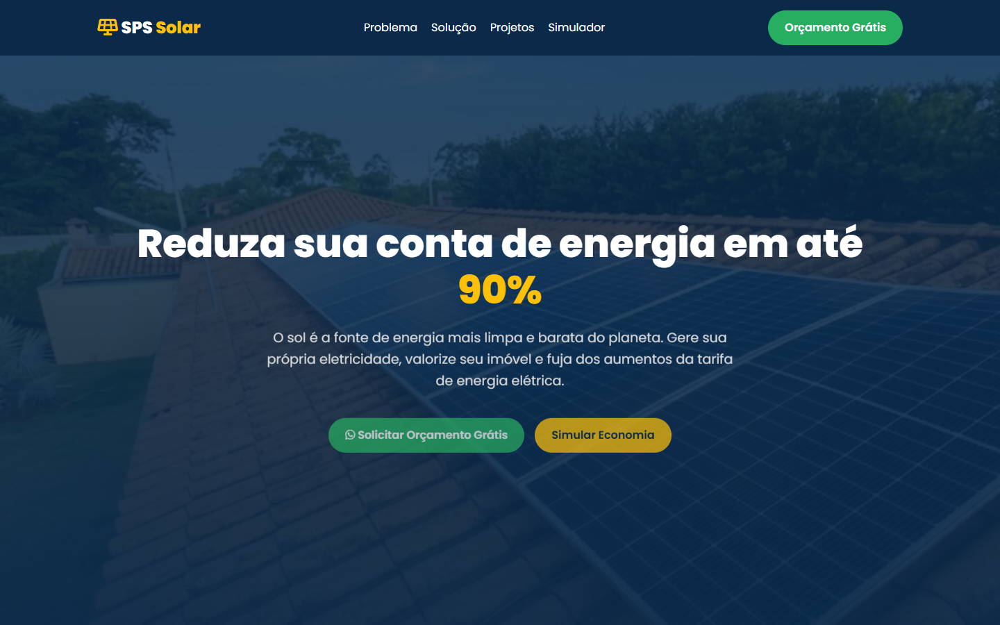

<div align="center">
  <h1>SPS Solar</h1>
  <p><strong>Landing page institucional responsiva para uma empresa de energia solar.</strong></p>
  <p>
    <a href="https://spssolar.com.br"><strong>▶ Ver site publicado</strong></a>
    ·
    <a href="#funcionalidades"><strong>Funcionalidades</strong></a>
    ·
    <a href="#como-executar"><strong>Executar localmente</strong></a>
  </p>
</div>

---

SPS Solar é uma página institucional estática para apresentar uma empresa de energia solar, seus projetos e um simulador de economia. A solução foi construída com HTML, CSS e JavaScript puros, sem framework e sem backend.

<div align="center">
  
</div>

> **Escopo:** a demonstração e a interface usam o conteúdo institucional da SPS Solar. As projeções e o simulador são estimativas estáticas de apresentação, não uma ferramenta de engenharia energética.

## Funcionalidades verificadas no código

- layout responsivo para desktop, tablet e celular;
- navegação por âncoras e menu móvel;
- seções institucionais de problema, solução, projetos, depoimentos e contato;
- animações de entrada com `IntersectionObserver` e respeito a `prefers-reduced-motion`;
- contadores animados para indicadores institucionais;
- gráfico comparativo anual com Chart.js;
- simulador de economia mensal e anual;
- chamadas para contato por WhatsApp;
- modal de oferta com memorização da sessão;
- metadados básicos, ícone e fonte personalizada.

## Tecnologias utilizadas

| Tecnologia | Função no projeto |
|---|---|
| **HTML5** | estrutura semântica e seções da landing page |
| **CSS3** | layout responsivo, animações, temas visuais e acessibilidade de foco |
| **JavaScript** | navegação móvel, animações, contadores, gráfico e simulador |
| **Chart.js** | gráfico comparativo de projeção tarifária |
| **Font Awesome / Google Fonts** | ícones e tipografia carregados por CDN |
| **Git / GitHub Pages** | versionamento e publicação do site |

## Arquitetura e organização

```text
index.html       Estrutura, conteúdo e seções da página
css/styles.css   Layout, responsividade, componentes e animações
js/script.js     Interações, gráfico, simulador e modal
img/             Logotipo, favicon e imagens institucionais
docs/            Captura real usada na documentação
```

A aplicação é estática: todo o conteúdo está no HTML e as regras de apresentação ficam no CSS. O JavaScript usa o DOM para aprimorar a navegação, observar a entrada das seções, calcular a simulação e desenhar o gráfico.

## Como executar

Não há dependências para instalar. Para apenas visualizar, abra [`index.html`](index.html) no navegador.

Para testar com um servidor local, use qualquer servidor estático já disponível. Por exemplo, com PHP:

```bash
php -S localhost:8000
```

Acesse <http://localhost:8000/>.

O projeto também pode ser publicado pelo **GitHub Pages** a partir da branch principal, configurando a fonte do site em **Settings → Pages**.

## Contato

O botão de orçamento abre uma conversa de WhatsApp com a mensagem predefinida. O link e o número de contato ficam no HTML e devem ser revisados antes de qualquer novo deploy.

## Acessibilidade e qualidade

- elementos interativos possuem estados de foco visíveis;
- a animação principal respeita `prefers-reduced-motion`;
- a interface possui `meta viewport` e atributos `lang`;
- a navegação móvel fecha ao selecionar uma seção.

## Aprendizados demonstrados

- estruturação de uma landing page institucional sem framework;
- responsividade com CSS Grid/Flexbox e breakpoints;
- integração de bibliotecas JavaScript por CDN;
- animação de entrada e contadores com `IntersectionObserver`;
- desenho de interface a partir de regras de negócio e conteúdo de negócio.

## Próximas melhorias

- revisar o desempenho e a disponibilidade dos recursos externos por CDN;
- mover contatos, textos e dados do gráfico para uma camada de configuração única;
- ampliar os testes de acessibilidade com navegação por teclado e leitor de tela;
- adicionar metadados de SEO social e uma imagem de compartilhamento;
- substituir o gráfico com dados ilustrativos por dados claramente identificados como estimativas;
- documentar um checklist de publicação para evitar divergência entre repositório e site.

## Observação sobre conteúdo

O repositório apresenta conteúdo institucional e depoimentos do site da SPS Solar. Eles não devem ser interpretados como métricas ou resultados de desenvolvimento produzidos pelo autor deste portfólio.

---

<div align="center">
  <sub>Projeto frontend de demonstração para a construção de uma presença institucional responsiva.</sub>
</div>
